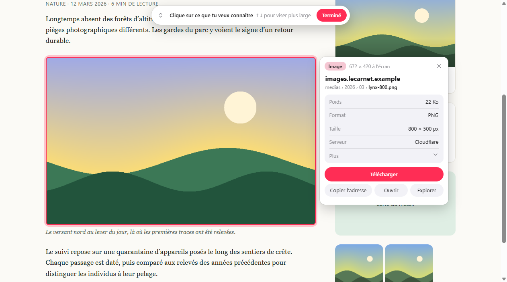
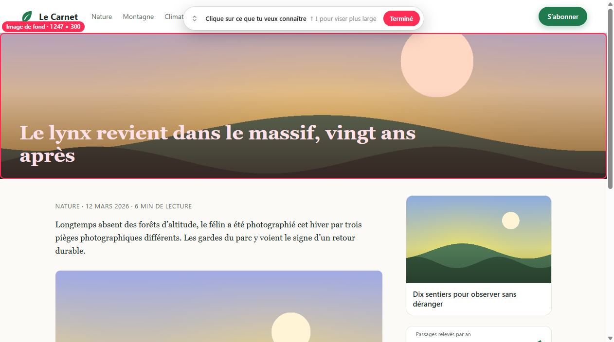
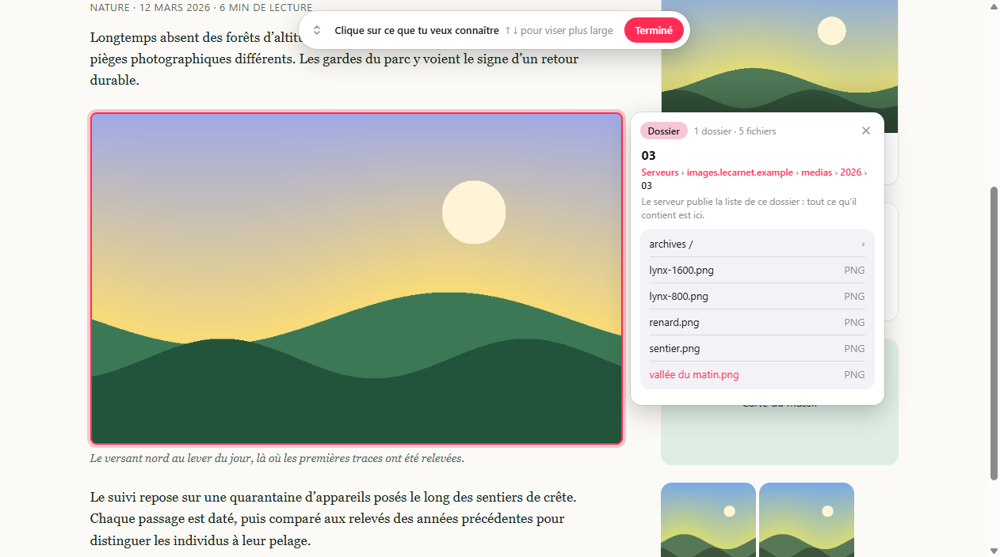
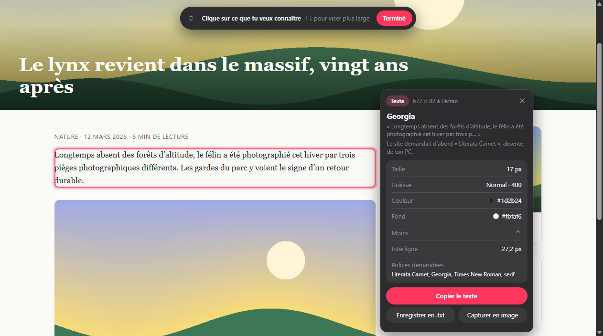
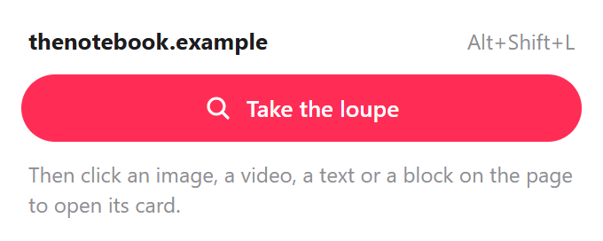

# Loupe

A Chrome extension that tells you where the thing you click comes from. Click an image, a video, a text or a block on any page: a small card shows the site that hosts it, its address cut into readable pieces, its weight, format and real size, and lets you download it.

## What it does

- **The loupe.** Click the toolbar button, then "Prendre la loupe", or press `Alt+Shift+L`. The element under the mouse is outlined in pink with its kind and size; a click opens its card. While the loupe is in hand the page receives nothing: links are not followed and videos do not start. `↑` takes a wider element, `↓` a narrower one, `Esc` puts the loupe down.
- **Images, videos, sounds, frames.** The host in large, then the folders and the file name, then weight, format, real size in pixels, duration, whether it came from Chrome's cache or the network, and who hosts it when the server lets it show (Cloudflare, Amazon, Google, Fastly, Wikimedia and a few others). "Plus" unfolds the rest: last modification date, protocol, alternative text, full address.
- **It finds what a right-click cannot.** Background images, images under a transparent layer, icons that ignore the mouse, images inside shadow DOM, drawings written in the page (inline SVG).
- **The largest version.** When the page offers several sizes of an image (`srcset`, `<picture>`), or shows a Wikipedia thumbnail, "Télécharger" takes the largest one and the card shows its weight.
- **Texts.** The font actually used (the first one of the list that is really available, with a note when the site asked for another one that is missing), size, weight, text colour and background colour. A click on a colour copies its code.
- **Blocks.** Background, rounding, border, shadow and padding of a button, a card, a banner.
- **Download.** Files go to a `Loupe` folder inside Downloads. A text can be saved as `.txt`, an inline drawing as `.svg`, and anything at all as a picture of what is on screen ("Capturer en image").
- **Where a text comes from.** "Données" on the card of a text or a block lists the page itself and the data addresses the page has queried since it loaded. "Chercher mon texte" reads them again and puts first the one that contains the text, with the place where it sits in the answer (for example `questions › 0 › intitule`).
- **The explorer.** "Explorer" opens the folder a file lives in. It lists what the page knows there (what it loaded, what it shows, what it links to), lets you walk up the address folder by folder, and lists every server the page talks to. When a server publishes the listing of a folder, the whole listing is shown.

The interface is in French. The site in the screenshots is made up for the demonstration.

## Install

The extension is not on the Chrome Web Store, so it is loaded by hand:

1. Download this repository (**Code**, then **Download ZIP**) and unzip it, or clone it.
2. Open `chrome://extensions` and turn on **Developer mode**.
3. Click **Load unpacked** and choose the folder.
4. Reload the tabs that were already open.

## What it cannot do

- **Streaming video.** YouTube, Netflix and similar sites do not send a file: they send hundreds of small pieces, some of them encrypted. There is no address to download, and Loupe does not try to rebuild the video. The card says so and only offers a picture of the frame on screen.
- **Closed folders.** Almost every site refuses to list its folders. The explorer then shows only what the page itself knows, and says that the server refused. Loupe never guesses file names.
- **Who made it.** The address says which server hosts a file, not who created it.
- **Inside frames from other sites.** An embedded frame (an ad, a map, a player) is seen as one element: Loupe gives the address of the frame, not of what is inside.
- **Things drawn by code.** A canvas has no source file; only a picture of it can be saved.
- **Protected pages.** Chrome does not let extensions work on its own pages or on the Chrome Web Store.
- **The card can cover what is next to it.** The cross closes it.

## How it works, and what that means

Nothing runs until the loupe is asked for: no script is added to pages, and the background script only wakes up for a click in the card.

- **Reading the page.** The address, the size and the styles are read from the page itself. Load time and cache come from what Chrome measured while loading the page, when the server allows it to be read.
- **Asking the server.** A page cannot read the weight or the type of a file that comes from another site. For those, the background script asks the file's own server for its headers only (not the file), without cookies and without saying which page asks. This is one request per card, two when a larger version exists, and one per folder opened in the explorer.
- **Reading data again.** "Chercher mon texte" reads the page's data addresses from inside the page, the way the page did, so with your session on that site. It only reads (`GET`), at most 40 addresses, and only when you click. An address the page reached by sending something (a form post) cannot be replayed and is marked "illisible". The database itself is never visible, only these addresses and their answers.
- **What is refused.** Loupe only saves images, videos, sounds and texts, and names the saved file itself with a matching extension: a page cannot make it save a program disguised as a picture. Addresses on the local network are never queried unless the page itself is on it. Only real mouse clicks and key presses count, and the card lives in a closed shadow root that the page cannot read.
- **Cost.** Putting the loupe on a page takes a few milliseconds; aiming costs about 1 to 1.5 ms per mouse move while the loupe is in hand, and nothing otherwise.

## Privacy

Loupe has no server of its own and keeps nothing: no storage, no history. The only requests it makes are the ones described above: to the servers of the files you click on, and to the page's own data addresses when you ask where a text comes from.

| Permission | Why it is needed |
| --- | --- |
| Access to all `http` and `https` sites | Ask a file's server for its weight and type, and read a folder listing. This is why Chrome says the extension can read and change data on all sites |
| `activeTab` and `scripting` | Put the loupe in the current tab when you ask for it, and take the picture for "Capturer en image" |
| `downloads` | Save files in Downloads › Loupe, and show a saved file in its folder |

## License

[MIT](LICENSE) © 2026 Yanis Arris
